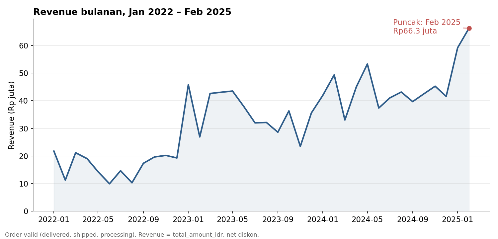
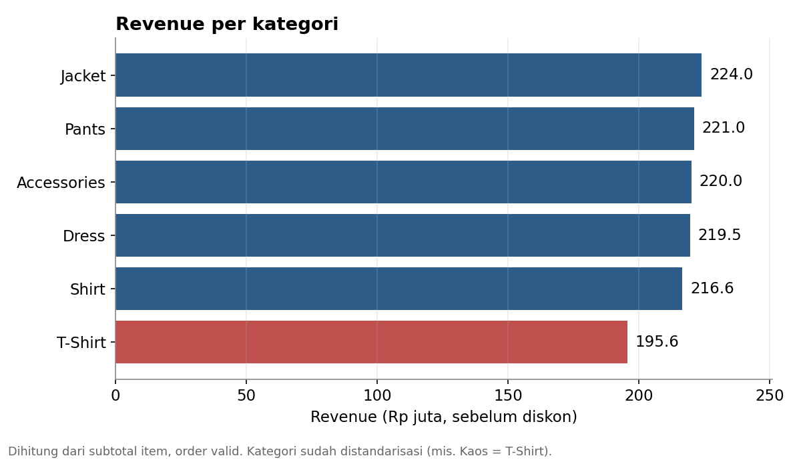
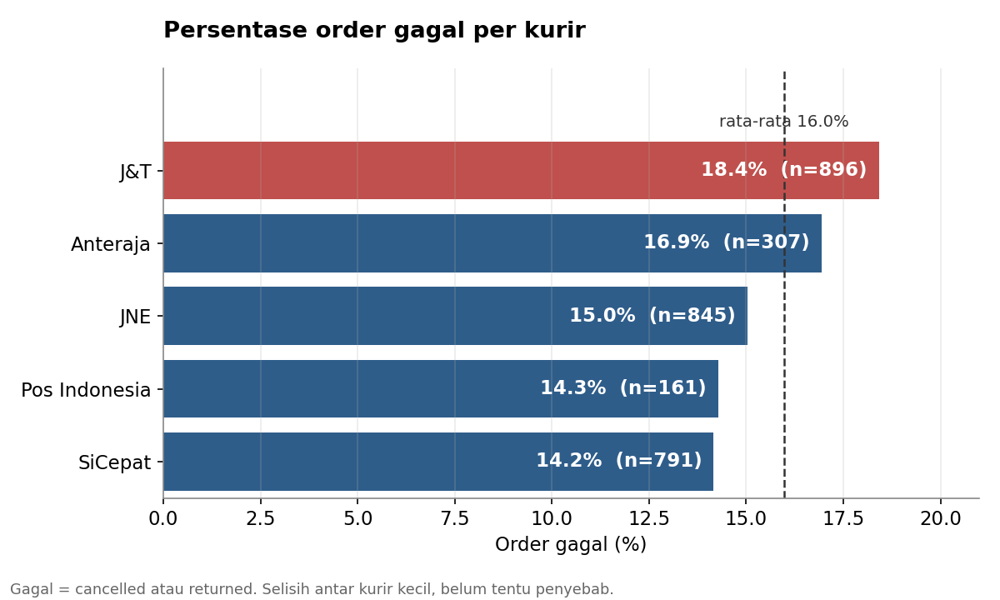

# Gayanara E-commerce: Analisis SQL (MySQL)

Proyek portofolio data analyst kedua. Dataset yang sama dengan [proyek Python saya](https://github.com/pajareeeee/gayanara_ecommerce_analysis), tapi seluruh cleaning dan analisis dikerjakan dengan SQL (MySQL).

> Dataset simulasi "Gayanara: Toko Fashion Online" dari [Ngulik Data](https://ngulikdata.com/datasets/gayanara). Semua data bersifat fiktif.

## Pertanyaan Bisnis

1. Berapa total revenue, jumlah order valid, dan rata-rata nilai per order (AOV)?
2. Tiga bulan mana yang revenue-nya paling tinggi?
3. Kategori produk mana yang paling besar kontribusinya?
4. Lima kota mana yang paling banyak menyumbang revenue?
5. Apakah order yang memakai promo nilainya lebih besar?
6. Berapa total diskon yang sudah diberikan?
7. Kurir mana yang order-nya paling sering gagal?
8. Metode pembayaran mana yang order-nya paling sering gagal?
9. Bagaimana pertumbuhan revenue dari bulan ke bulan (MoM)?

## Isi

| File | Fungsi |
|---|---|
| `queries/01_cleaning.sql` | Membuat view bersih: standarisasi kategori, flag email dipakai bersama, flag order sebelum registrasi, definisi revenue valid, validasi total order |
| `queries/02_analysis.sql` | 9 query analisis: ringkasan revenue, bulan tertinggi, kategori, kota, dampak promo, total diskon, order gagal per kurir dan metode bayar, pertumbuhan revenue bulanan (MoM) |

## Keputusan Cleaning

- Data mentah tidak diubah, semua cleaning dibuat sebagai VIEW
- 3 email dipakai 2 customer berbeda: diberi flag, tidak dihapus
- 795 dari 3.000 order tercatat sebelum tanggal registrasi: diberi flag, tetap dipakai
- Revenue = `total_amount_idr` (net diskon, belum termasuk ongkir), hanya status delivered, shipped, processing
- Order gagal = semua order di luar status revenue valid di atas (3.000 - 2.521 = 479 order)

## Temuan Utama

- Revenue Rp1,27 miliar dari 2.521 order valid, rata-rata Rp501.920 per order
- Bulan tertinggi: Feb 2025 (Rp66,3 juta)
- Lima kategori berselisih tipis, T-Shirt paling rendah (Rp195,6 juta, dihitung dari subtotal item sebelum diskon)
- Promo dipakai 41% order, nilai ordernya 6% lebih kecil setelah diskon
- 16% order gagal, J&T (18,4%) dan OVO (18,7%) tertinggi

## Insight dan Rekomendasi

- **Revenue tumbuh.** Naik dari Rp198,8 juta (2022) ke Rp513,2 juta (2024). Puncak Feb 2025 adalah bulan terakhir di dataset, jadi belum bisa dilihat apakah tren naik berlanjut.
- **Promo tidak mengubah ukuran keranjang.** Nilai keranjang sebelum diskon hampir sama antara order promo dan non-promo (Rp515.199 vs Rp513.830), jadi selisih 6% pada nilai bersih murni berasal dari diskon. Total diskon Rp31,4 juta (sekitar 2,5% dari revenue). Data ini belum bisa menjawab apakah promo menambah jumlah order; untuk itu perlu pembanding periode sebelum dan sesudah promo atau A/B test. Rekomendasi: ukur dulu efek promo ke jumlah order sebelum memperluasnya.
- **Kategori hampir seimbang.** Tidak ada satu kategori yang jadi tumpuan revenue. Untuk menilai kategori mana yang paling menguntungkan, diperlukan data margin per kategori.
- **Order gagal 16% adalah area yang paling layak ditelusuri.** J&T dan OVO sekitar 4 poin di atas yang terendah (SiCepat dan GoPay 14,2%), tapi selisih ini belum diuji secara statistik, jadi belum bisa disimpulkan sebagai penyebab. Rekomendasi: telusuri per status (cancelled dan returned) dan per kota sebelum mengganti vendor atau metode bayar.
- **Keterbatasan.** Dataset simulasi, jadi pola musiman dan perilaku pelanggan tidak bisa dianggap cerminan bisnis nyata.

## Visualisasi

## Cara Menjalankan

1. Unduh dataset gratis dari [halaman Ngulik Data](https://ngulikdata.com/datasets/gayanara) (perlu isi nama dan email)
2. Buat database `gayanara` di MySQL, lalu impor 5 file CSV sebagai tabel: products, customers, orders, order_items, reviews (kolom pertama = nama kolom)
3. Jalankan `queries/01_cleaning.sql`, lalu `queries/02_analysis.sql`

Diuji dengan MySQL (Laragon + phpMyAdmin).

## Skill yang Dipakai

JOIN, subquery, CTE, window function (LAG), CASE WHEN, GROUP BY dan HAVING, agregasi, COALESCE dan NULLIF, CREATE VIEW, fungsi tanggal